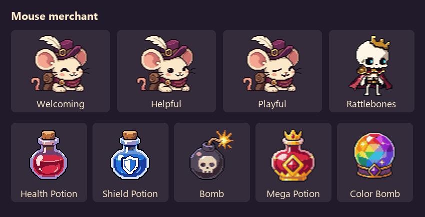
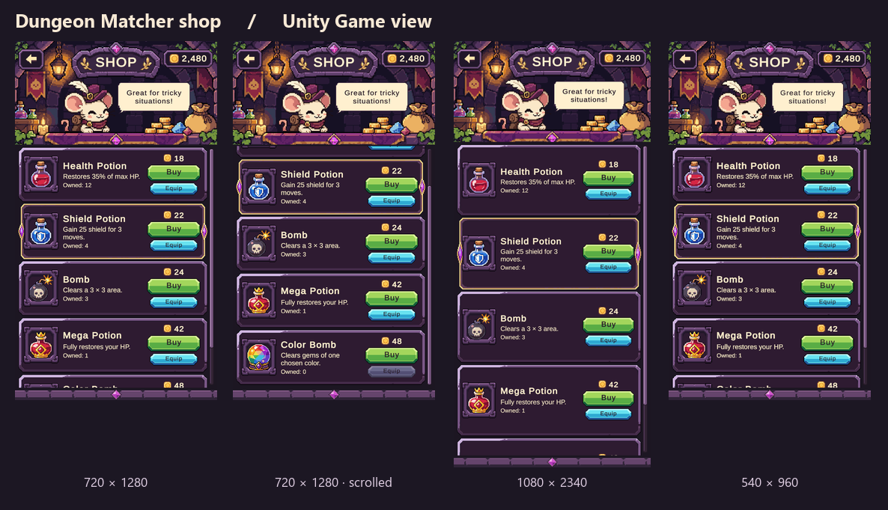
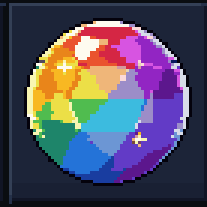
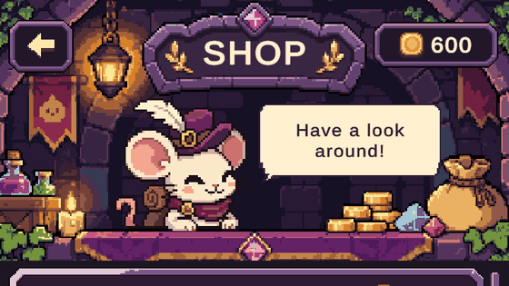

# Mouse merchant

The approved mouse leans on the counter with both paws. Happy, Helpful and Playful share one registration point, so the hat, ears and counter contact stay put when dialogue changes. The banded faceted orb represents the shop Color Bomb. The alternate gem cluster is retained here for comparison.

The art came from four PixelLab jobs using the supplied mockup. The image hashes, seeds, job IDs, reference roles and final sprite dimensions are in [PixelLab.json](PixelLab.json). The UI plaques and icons were sliced at native resolution in LibreSprite. Every runtime PNG has a corresponding editable file in [Native](Native).

The alcove and foreground counter meet at row 146 of a 320 × 164 composition. Unity renders the mouse between them. Prices, inventory counts, comments and button labels are live text. On the board and in the equipped bomb slot, the same orb appears free of its setting. Angled blue and violet facets follow a circular 58 × 58 outline centered on a 64 × 64 tile. A white diagonal reflection crosses the whole gem on the existing 32-frame idle cycle. The pedestal belongs to the shop display.

The shop uses the existing Main Menu entry point. The five stock counts and two equipment choices are saved by AccountProgression. Game-scene tests use disposable accounts.

## Unity verification

On the original shop commit `54361aa4`, the Unity 6000.3.19f1 validator and all 47 tests across the merchant, Balance V1, continuation and menu review suites passed. The shop was captured at 540 × 960, 720 × 1280 and 1080 × 2340. The UI test also checked a simulated asymmetric safe area, the fifth item after scrolling, a purchase, equipping and returning to the menu. The Game scene tests exercised supply use, cancellation, temporary shield expiry and resuming a confirmed Color Bomb. Physical-device touch and cutout testing remains outstanding.

## Shop alignment and board gem

The board and equipped bomb slot use a 58 × 58 rainbow gem on a 64 × 64 canvas. The shop keeps its display stand. The 32-cel idle repeats every 2.56 seconds. The white diagonal reflection crosses every colored facet while the silhouette stays fixed. Reduced motion shows the still gem.

[Editable animation](../BombReadability/SelectedIdles/Editable/Star.aseprite) · [Board master](BoardColorBomb.png) · [Round outline in the Game scene](Round-color-bomb-in-Unity.png) · [Before and after in the shop](Shop-alignment-comparison.png)

The revision passed the repository validator and 13 affected Unity tests on 6000.3.19f1. Those tests cover all five item sockets, prices aligned above their buttons at three portrait sizes, scroll and purchase behavior, the equipped Color Bomb icon, idle and reduced-motion behavior, and an actual board Color Crystal swap. All 32 native cels also passed the LibreSprite round-trip and glint coverage checks.

All five items have a shared inset inside the shop socket. At 720 × 1280, each silhouette has at least eight rendered pixels of clear space before the inner bevel. The previous layout left zero at the closest point. The shop tests passed at 540 × 960, 720 × 1280 and 1080 × 2340. [Compare all five items in Unity](Shop-item-padding.png).

## Merchant reactions

The mouse tilts his head on a 2.56-second loop with both paws resting on the counter. A soft [three-note hum](../../Assets/_Game/Resources/UI/MerchantMotion/MerchantHum.wav) plays intermittently and follows the sound-effects setting. Dialogue uses the speech bubble. Every successful purchase gets a line about that item. After 20 seconds of browsing he makes an impatient remark, then waits 30 seconds between further remarks. Buying or equipping resets that wait.

Back starts a one-second farewell. He waves one paw, ducks behind the counter and leaves a dissolving puff before Home appears. Reduced motion holds a single wave pose for 0.28 seconds. Reopening the shop starts a fresh greeting.

The approved mouse still is the drawing source. [Humming](Native/Humming.aseprite), [talking](Native/Talking.aseprite) and [goodbye](Native/Goodbye.aseprite) are editable native animations. [The production script](author_merchant.py) rebuilds the cels and original hum. The runtime exports use 63 × 62 cells and retain the existing counter registration.

The Unity 6000.3.19f1 repository validator and 14 affected tests passed. Main Menu coverage includes the first patient wait, purchase dialogue for all five items, audible-source playback and mute, exit input locking, reopening and reduced motion. The board suite also exercised an actual Color Crystal swap. The preview combines real Game-view captures and shortens the long wait before the impatient remark.

[Watch the Unity preview with the merchant hum](Merchant-in-Unity.mp4).
