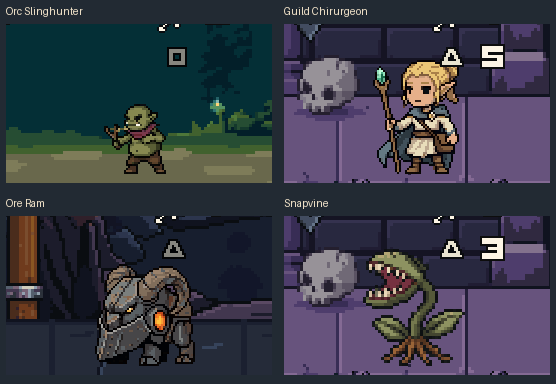

# Motion continuity and enemy shading

[Compare the original and repaired sprites](Review.html). The player opens on the Sword Knight’s second idle exposure. Switch off **Zoom to repair** to see the whole pose, or choose the Ore Ram to compare how an entire material reads in motion.

## What changed

Nine Dungeon idles had local defects in the raised drawing. The Barricade Villager kept a stripe from his lifted bundle across his upper trousers. The Sword Knight, Knight Captain, Royal Swordsman, King, Shield Knight, Spear Guard, Town Marshal and Royal Lancer had openings through equipment or clothing. Across those nine sheets the complete before/after difference is **59 native pixels in exposure 2**. Every other drawing in those loops is pixel-identical to its baseline. The previous Miner correction is a separate 26-pixel example.

| Enemy | What read poorly at game size | What changed |
|---|---|---|
| Ore Ram | Several almost identical gray bands softened the broad slate plates. | Combined the intermediate grays and horn browns. The orange core, eye and plate boundaries retain their contrast. |
| Orc Slinghunter | Narrow olive bands fragmented the brow, arm and belly. | Grouped the skin shadows through the idle, release and recovery. The tusks, scarf and sling keep their identifying colors. |
| Guild Chirurgeon | Fine pale-gold bands competed along the hairline and ponytail. | Consolidated those bands inside the hair on every pose, including the staff raise. |
| Snapvine | Intermediate greens broke up the jaw and leaves during the bite. | Simplified the plant greens through the fallback, bite, recoil and fall. The teeth and mouth retain their distinct values. |
| Grand Delver pilot | The apron, plated shoulder and boots blended on a very small figure. | Separated leather from steel through the pilot’s actions, fallback, ejection and the four on-foot exposures in the reserve controller’s remount. |

The shell highlights on the Nacre Duelist and the Halberdier’s pearl-white eyes carry their faction and material at game size. The gilded rim of the Guild Bulwark’s shield and the Ranger’s musket also remain legible in motion. These were retained. Broad, clean color fields are part of the target style.

## Coverage and method

The [per-clip ledger](coverage.csv) covers **499 Unity clips**. Of those, 465 actor clips contain 4,343 timed sprite keys across 90 identities and forms. The other 34 clips contain 3,200 keys, including environment loops and alternate or archived assets. The review decoded the bound sprite IDs, inspected ordered motion strips and checked adjacent exposures at a fixed registration. All 495 referenced textures use point filtering with mipmaps off. Sixty-nine small one-exposure reversals were flagged for closer comparison. Examples retained after inspection include blinks, glints, impacts and projectile releases.

The color columns describe opaque, horizontally or vertically adjacent pixels. The close-color percentage counts neighboring colors differing by at most 18 in every RGB channel among all unequal-color contacts. The measurements locate candidates. Each edit was chosen by its material and viewed at native size. For example, the Chirurgeon’s interrupted hair bands could be simplified even though her overall close-contact percentage rose slightly.

The 78 serialized or code-driven presentation sequences in the [effects inventory](../effects-coverage.csv) have 2,529 entries. Their source textures matched the prior reviewed digests. The procedural inventory covers 124 components. Four source files differed since that inventory and were rechecked for presentation ownership: enemy move intent, the combat status strip, Court flood and the player status panel. Procedural effects were checked at the source level. The runtime checks below cover the named scenarios.

## Production verification

LibreSprite reopened all 28 revised masters. The exported visible pixels, alpha, and exposure durations matched the registered drawings in the 26 bound clips and two fallback textures. The Snapvine’s terminal death hold is stored as two native durations that sum to one displayed hold. The approved Golden Register examples still extract identically, including the Royal Swordsman’s first pose in the revised idle sheet.

Unity 6000.3.19f1 validated source `000a2815615bbd4de844d7aeb710a81a11ff7725`. Its import check passed 17,494 assertions over 395 textures and 2,951 sprite IDs. It checked 5,902 individual pose and viewport combinations at 1080 × 1920 and 1080 × 2400 in the production Game scene. All ten focused regression tests passed, including the pilot’s remount, both Slinghunter contact tests and the Guild healer’s cast. These are editor captures. Physical-device motion and readability remain for human review.

[Per-texture pixel counts, editable sources and timing](repairs.json) · [Final test cases and capture provenance](validation.json) · [Miner correction](../README.md)
