# Approved enemy animations in the Game scene

Unity 6000.3.19f1 rendered all 13 clips on the production Game canvas at 7356a2c804e0c9702f4f48f1b811509006c41875. Each animation below is cropped from the Game view. The [interactive gallery](Review.html) also includes the full scene. Open the HTML locally to switch characters and clips.

| Enemy | Idle | Revised attack or heal |
|---|---|---|
| Guild Swordsman | 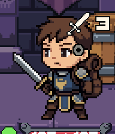 | Previously approved basic |
| Guild Bulwark | 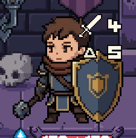 | 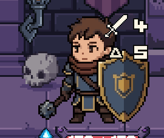 |
| Elven Chirurgeon |  |  |
| Nacre Halberdier | 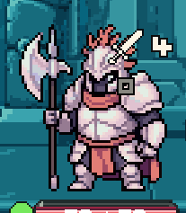 | 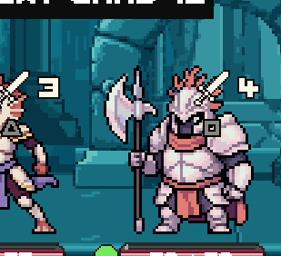 |
| Elven Pathblade | 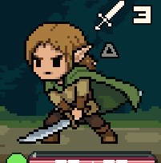 | 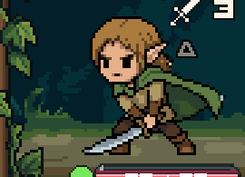 |
| Orc Slinghunter | 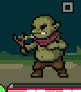 | 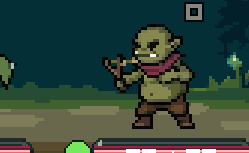 |
| Iceborn Axeman | 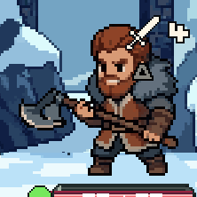 | 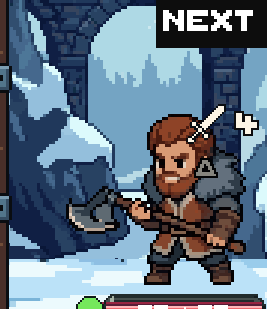 |

## Slinghunter combat checks

- Slinghunter contacts=1 · attributed=1 · HP 100->100 · shield 5->0 · move=1
- Slinghunter contacts=1 · attributed=1 · HP 100->95 · shield 0->0 · move=1

Both checks used an accepted board swap and the normal attack sequence. They counted the orc’s resolved attack contacts and the player’s attributed damage events through recovery. The shield test used the game’s minimum shield grant of five.

The final focused Unity suite passed 18 of 18 cases. The first run passed 17 of 18. Its shield test expected a one-point grant, which the game correctly rounded to five. The corrected fixture verifies the actual shield grant, one contact, its attribution and the remaining HP after recovery. The production combat code was unchanged by the test correction.

[Per-clip capture and validation record](evidence.json)
